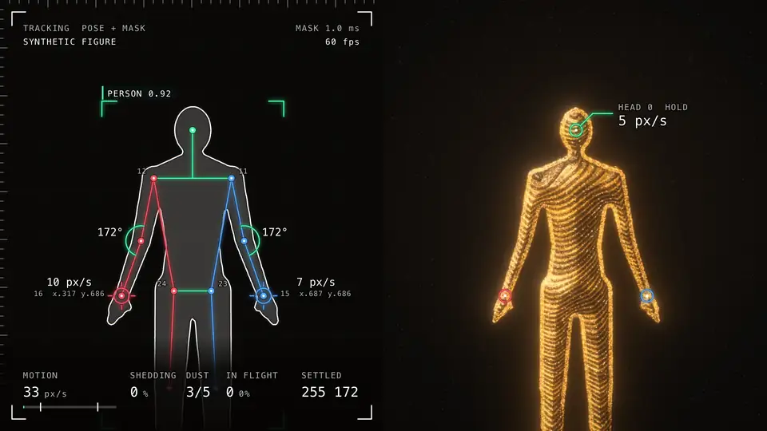
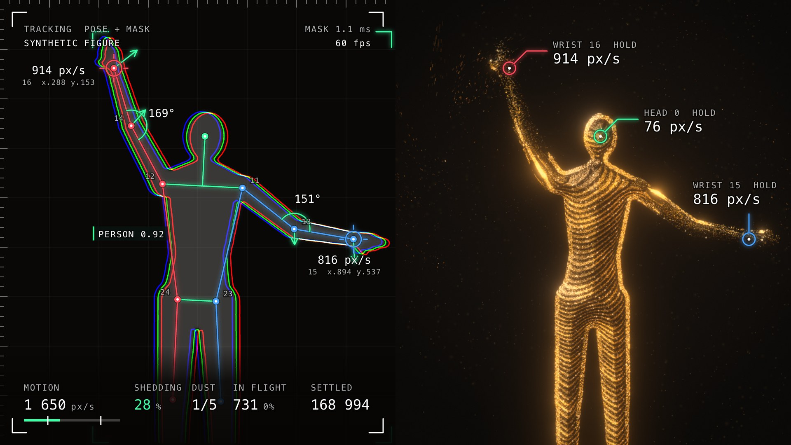
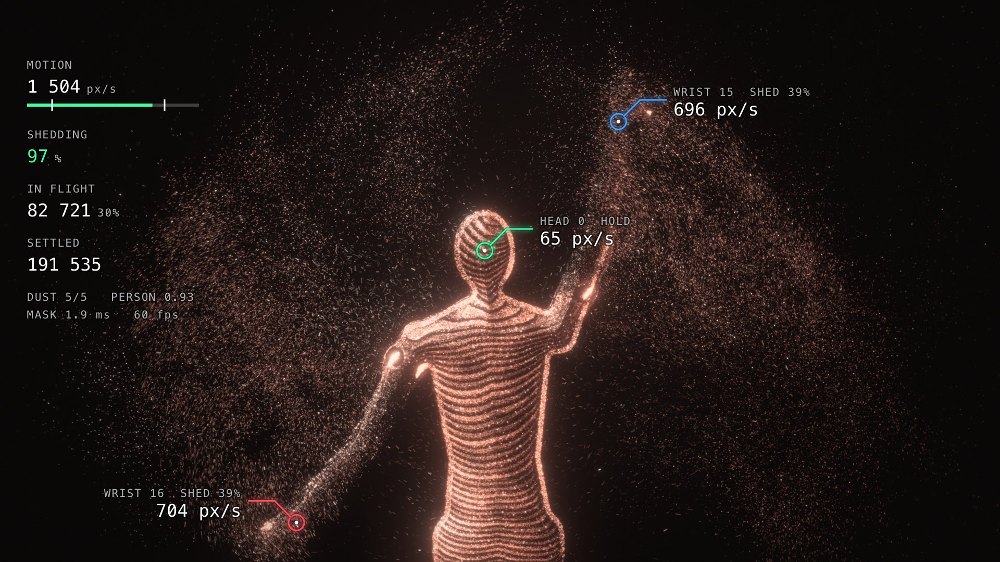
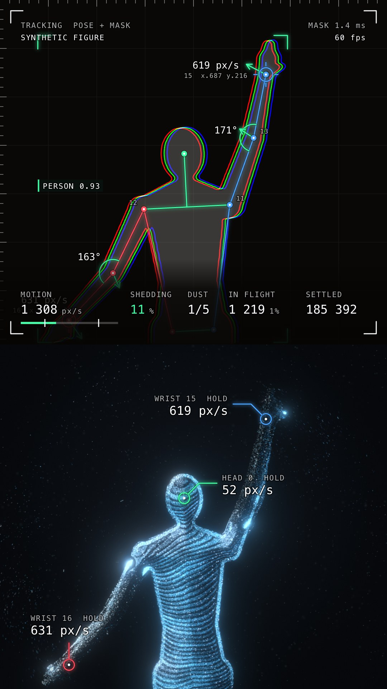

# Dust

A webcam effect for the browser: your body as a figure of flowing gold dust, with the tracking that drives it drawn on screen.



**Try it: https://native.express/lab/dust** (needs a camera; add `?demo=1` to watch the built-in figure instead)

The figure follows you closely as you move. Whip an arm and grains tear off it and stream behind, then drift back and settle into your shape again. Next to it, the camera picture shows what the machine sees and measures: pose skeleton, segmentation outline, joint angles, velocity vectors and live numbers. The clip above is the built-in demo figure with the dust dial at 3 of 5.

| | | |
| --- | --- | --- |
|  |  |  |

## Keys

| Key | What it does |
| --- | --- |
| `R` | Start or stop recording; the clip lands in your downloads |
| `A` | Stage: portrait 9:16, landscape 16:9, fill the window |
| `V` | Layout: split (camera and dust side by side), picture in picture, effect only |
| `T` | Tracking overlay: RGB, plain (white and one accent), skeleton only, off |
| `[` `]` | Less or more dust, from 0 (clean, almost nothing tears off) to 5 (very dusty); starts at 1 |
| `P` | Next palette: Gold, Pearl, Rose gold, Glacier (`1` to `4` pick one directly) |
| `Space` | Scatter the whole figure |
| `M` | Record wide stages as a 1080 × 1920 reel frame, on or off |
| `C` | Move the small picture to another corner |
| `D` | Switch between the camera and the demo figure |
| `F` | Full screen |
| `H` | Show or hide the key hints |

## Recording

Press `R`, perform, press `R` again. The clip contains exactly what the stage shows: dust, camera picture and tracking overlay. The key hints and the red recording light are not part of it. There is no sound.

The clip has the size of the stage, not of the window:

| Stage | Clip |
| --- | --- |
| Portrait | 1080 × 1920 |
| Landscape | 1920 × 1080 |
| Fill | the window's proportions with the long side at 1920, for example 1920 × 1200 on a 16:10 screen |
| Any wide stage with `M` on | 1080 × 1920, the wide picture centred on near-black, with the overlay drawn 1.4 times larger so the numbers stay readable |

A wide window starts on Fill and a tall one on Portrait. The stage cannot be changed while a recording is running.

The file is MP4 (H.264) where the browser's recorder can encode it, and WebM otherwise. In the Chromium build this was tested with, it is MP4.

## Run it locally

```sh
npm install
npm run dev
```

Open http://127.0.0.1:5182/ and allow the camera. Stand far enough back that your arms stay in the frame, then sweep one. With no camera, or if permission is denied, it falls back to the demo figure.

`npm run build` writes a static site to `dist/`. Every URL in it is relative, so it can be hosted under any path; `python tools/serve.py` serves the build at `/`, at `/webcam-dust/` and at `/lab/dust` to check that.

## Options in the address bar

- `?demo=1` starts with the demo figure instead of the camera.
- `?aspect=landscape` (or `portrait`, `fill`) chooses the stage, and `?reel=1` turns the reel frame on.
- `?view=pip` (or `split`, `solo`), `?hud=plain` (or `full`, `skeleton`, `off`) and `?palette=3` choose the starting look.
- `?count=800000` sets the number of grains. Lower it if the picture stutters.
- `?scale=0.75` renders the dust below the stage's resolution, which also helps on a slow GPU.
- `?video=clip.webm` runs the effect on a video file instead of the camera.
- `?t.<name>=<number>` overrides any value in the `tuning` object in `src/particles.ts`, for example `?t.dust=3&t.spacing=0.011`.

## How it works

**From camera to a surface.** Each camera frame is mirrored, cropped to the stage and segmented with MediaPipe's selfie model. The mask is smoothed, then turned into a signed distance field by jump flooding, which gives every point its depth inside the body and the direction of the nearest edge. MediaPipe's pose landmarker runs alongside for the joints. The dust itself needs only the mask; the pose feeds the overlay.

**Grains that ride the body.** Up to 800,000 grains live in float textures and are simulated on the GPU; only as many as the figure's size needs are in use at once. A settled grain sits on a contour line of the distance field, bent by slow noise so the lines run like ripples in sand, and glides along it. Each frame it is moved by however far the body's surface moved under it, so it keeps its place on the body, and the contour lines are laid out in coordinates that are carried along the same way. A coarse count of where the grains are steers new ones to wherever the figure is thin, and a share of grains circles just inside the outline so the silhouette always reads.

**Tearing and return.** How fast each part of the body moves is measured by tracking the local centre of the mask from frame to frame. Where that speed passes a threshold, grains are thrown with the limb's velocity, carried by the air for a moment, and then steer home. A core share of grains is locked to the body and never torn off by speed; the dust dial changes that share, the thresholds and how long dust lingers.

**Drawing.** Grains are drawn with additive blending into an HDR buffer, bloomed and tone-mapped. That is plain WebGL2 with no rendering library. The dust, the camera picture and the overlay are then composed on a single 2D canvas, which is what you see and what gets recorded.

**The measuring overlay.** Every number comes from the pipeline. Red marks the left side of the picture, blue the right, green the centre line and anything measured.

- **Motion** is the fastest body speed anywhere in the picture, in output pixels per second. The two ticks on its bar mark the speed where grains begin to tear off and the speed where all but the core do.
- **Shedding** is how hard that speed is tearing grains away, 0 to 100 %. **Dust** is the dial.
- **In flight** and **Settled** are head counts of the grains, taken on the GPU ten times a second.
- The arrows on wrists and elbows show where each joint will be a tenth of a second from now. The labels on the dust figure give the speed under each wrist and the head and whether that part is holding or shedding.
- **Person** is how sure the segmenter is, on average, about the pixels it calls a person. The small numbers beside joints are MediaPipe's landmark numbers, and the wrists also show their position across the picture.
- The outline is drawn once per colour channel. At rest the three lie on top of each other and read as white; when you move fast they pull apart along the direction of travel.

## Performance

Measured on an Apple M5 Pro in headless Chromium 153 on Metal, with a 1920 × 1080 stage and both models running on a video of a person:

| Grains | Mean frame time |
| --- | --- |
| 520,000 | 17.1 ms |
| 1,000,000 | 17.3 ms |
| 2,000,000 | 22.8 ms |

So 60 frames per second holds up to about a million grains on that machine; the default is 800,000. With the demo figure, recording a 1920 × 1080 clip kept that rate (537 frames in 9 seconds). Other hardware has not been measured. If it stutters, lower `?count=` or `?scale=`.

## Browser support

Developed and tested in Chromium 153 on macOS, on Metal and on software rendering. It needs WebGL2 with float render targets (`EXT_color_buffer_float`), WebAssembly, and `MediaRecorder` with canvas capture for recording. Firefox, Safari and phones have not been tested.

## Privacy

Camera frames are processed in your browser. The page makes no network requests beyond loading its own files, and recordings are saved by your browser to your downloads.

## Known limits

- It has only been seen on the built-in synthetic figure and on one close-up clip of a real person. Arms, walking and turning have not been checked on a real body.
- In a very fast arm sweep the limb stays attached and bright but is thinner than at rest.
- Airborne dust reads partly as an even spray; it does not yet form the ribbons it should.
- The selfie model is made for people within a couple of metres of the camera. Further back the mask may be rougher.
- The lite pose model jitters a little. The joints are smoothed, which costs a small delay.
- In the reel frame the wide picture is small, so the overlay gets crowded.

## Tools

Scripts for looking at the result without a camera, using Playwright (`pip install playwright && playwright install chromium`). Start `npm run dev` first. They drive headless Chromium on Metal by default; pass `--angle swiftshader` on a machine without it, and `--url` if the server is on another port.

The demo figure stands (0 to 2.6 s), walks across and back (to 5.2 s), turns side on (to 6.8 s), sweeps its arms (to 9.4 s) and then holds a pose.

```sh
python tools/shoot.py --times 2.4,3.9,6.0,7.8,8.8,13 # stills of the demo at chosen moments
python tools/shoot.py --palette 4 --view pip
python tools/shoot.py --width 1920 --height 1080    # a wide window, so the stage fills it
python tools/record.py --seconds 8                   # press R, record, check the clip with ffprobe
python tools/record.py --width 1920 --height 1080 --extra reel=1
python tools/camcheck.py                             # camera path with Chromium's fake camera
python tools/camcheck.py --clip me.webm              # camera path with a clip of a person
python tools/sheet.py sheet.jpg tools/out/*.png      # tile stills side by side (needs ffmpeg)
python tools/serve.py                                # serve dist/ at the three hosting paths
```

## Credits and licence

Segmentation and pose tracking are done by [MediaPipe](https://github.com/google-ai-edge/mediapipe) (`@mediapipe/tasks-vision` and two of its models, all Apache 2.0). The runtime is copied from `node_modules` into the site at build time and the models live in `public/models`, so nothing is fetched from a CDN. Details are in [THIRD_PARTY_NOTICES.md](THIRD_PARTY_NOTICES.md).

The code is by Robin Sadeghpour-Faraj and is released under the [MIT licence](LICENSE).
